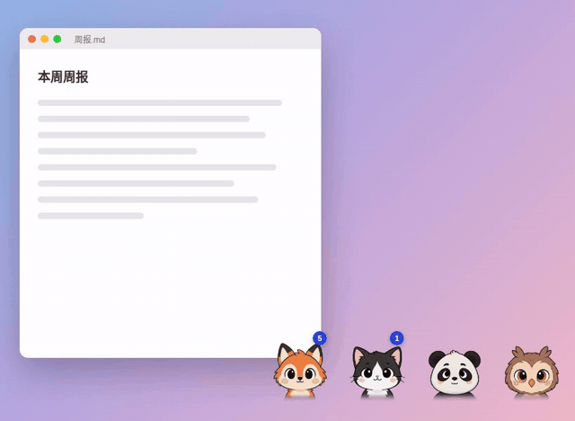
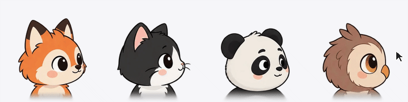

# m-awesome-desk-todo

**一直浮在你桌面上的可爱桌宠，同时也是你的待办清单。**
它就待在你眼前，抬眼就能看见，事情就不会忘。



> 目前只支持 **macOS**（Apple 芯片和 Intel 都行，macOS 11 以上），界面是中文。

## 为什么是它

**一只陪着你的小桌宠。** 它跟着你的鼠标转头，戳一下会眯眼笑、冒爱心，连戳会晕，你半天不动它就打起瞌睡。事情做完了，四只一起为你高兴。

**一个真正在用的 To-do。** 四只宠物各管一个分组：要做、在等、做完、归档。鼠标移上去清单就弹出来，移开就收起；任务拖到哪只宠物身上，就进了哪个分组。

**一直浮在桌面上，所以不会忘。** 普通的待办 App 关掉就看不见了，它不会：始终浮在所有窗口上面，切桌面、开全屏也一直在。想放哪儿就按住拖到哪儿，宠物以外的地方点击直接穿透到下面的窗口，不挡你干活。To-do 里的数字一直挂在它头顶，有过期的就变红。

**你的 AI 也能帮你管。** 全部待办是一份 Markdown 文件，Claude Code、Codex 这类 Agent 可以直接读写；跟它说「把今天会上定的三件事加进 To-do」，桌宠一秒内就更新。

## 它会有表情

| | |
|:---:|---|
|  | **跟着你的鼠标转头。** 鼠标在哪，它们就看向哪，上下左右九个方向。 |

|  |  |  |
|:---:|:---:|:---:|
| **戳一下**：眯眼笑、冒爱心、冒星星 | **连戳四下**：转圈圈，晕了 | **很久不动鼠标**：一起打瞌睡 |

|  |
|:---:|
| **今天到期的都做完了，或者 To-do 清空了：四只一起庆祝** |

还有一些小反应：任务进了谁的分组，谁就高兴一下；To-do 堆到 10 条以上，管 To-do 的那只隔一会儿就晕一下，提醒你该清一清了。

## 四只宠物，四个分组

| 位置 | 分组 | 数字 |
|---|---|---|
| 第一只 | **To-do**：要做的 | 头顶显示还有几条，有过期的变红 |
| 第二只 | **Pending**：在等别人、等结果的 | 头顶显示几条 |
| 第三只 | **Completed**：最近 7 天做完的，按日期分组 | 不显示，做完就不打扰你 |
| 第四只 | **Archived**：更早做完的、不打算做的 | 不显示 |

做完的事会自动记下完成日期，7 天后自动收进 Archived，清单不会越积越长。

## 安装

### 让 Agent 帮你装（推荐）

把这句话贴给 Claude Code、Codex 或别的能跑命令的 Agent：

```text
把 https://github.com/MengTang1114-open/m-awesome-desk-todo 装到我的 Mac 上，按仓库里的 AGENTS.md 帮我装好并配置。
```

它会帮你下载、打包、放进「应用程序」并打开，然后问你三件事：要深色还是浅色、四个位置放哪几只宠物、快速添加用什么快捷键。不想选就说「默认」。

### 自己装

需要 Node 18 以上。

```bash
git clone https://github.com/MengTang1114-open/m-awesome-desk-todo.git
cd m-awesome-desk-todo
npm install
npm run app        # 打包好的 App 在 release/mac*/ 里，拖进「应用程序」
```

第一次打开，To-do 里有 5 条「上手任务」，跟着做一遍就会用了。

## 怎么用

| 想做什么 | 怎么做 |
|---|---|
| 看清单 | 鼠标移到宠物上；移开自动收起，Esc 也行 |
| 加任务 | 清单底部输入框回车。可以顺手写 `#分类` 和日期：`交周报 #工作 周五` |
| 随时加一条 | 按 **⌥ 空格**，输完回车，Esc 回到刚才的 App |
| 完成 / 改 / 删 | 点圆圈完成，双击改名，悬停出现分类、日期和删除 |
| 换分组 | 把任务拖到另一只宠物身上，或拖到清单上方的标签上 |
| 挪宠物 | 按住任意一只拖，四只一起走，放哪儿都行 |
| 换形象 | 右键那只宠物 |
| 深色 / 浅色 | 清单右上角的按钮，或菜单栏爪印图标 →「外观」，默认跟随系统 |
| 让 AI 帮你管 | 菜单栏爪印图标 →「复制给 AI 的说明」，贴给你的 AI |

## 换形象

内置 57 个形象，右键任意一只宠物就能换：动物、各种职业的小人、小机器人，还有同一只狐狸的六种画风。默认是狐狸、奶牛猫、熊猫、猫头鹰。


形象来自 [page-mascot](https://github.com/nilbuild/page-mascot)（MIT，© Kamran Ahmed）。

**想要自己的？** 用任何生图模型（ChatGPT、Gemini、即梦……）按我们给的提示词出两张九宫格，交给你的 Agent，它会帮你抠图、调好大小，放进桌宠里。不用改代码，也不用重新安装。提示词和步骤见 [自己做一个桌宠形象](docs/make-your-own-pet.md)。

## 数据和设置

都在 `~/Documents/DeskPet/` 里，改了马上生效，你和 AI 都可以直接改：

| 文件 | 是什么 |
|---|---|
| `To-Do.md` | 全部待办 |
| `settings.json` | 外观、四个位置的形象、快捷键、Completed 留几天 |
| `pets/` | 你自己做的形象 |

<details>
<summary>To-Do.md 和 settings.json 的格式</summary>

```markdown
## To-do
- [ ] 周报 #工作 due:2026-10-25
## Pending
- [ ] 等设计稿回来 #工作
## Completed
- [x] 交水电费 #生活 done:2026-10-21
## Archived
- [x] 交房租 #生活 done:2026-10-01
- [-] 周末爬山 #生活
```

一行一条，`#分类`、`due:截止日期`、`done:完成日期` 都可以不写（做完的没写完成日期，会补成当天）。Archived 里 `[x]` 是做完的，`[-]` 是不做了。四个分组的标题别改（也认「待办 / 进行中 / 已完成 / 归档」）。

```json
{
  "theme": "system",
  "pets": ["fox", "cat", "panda", "owl"],
  "hotkey": "",
  "keepCompletedDays": 7
}
```

- `theme`：`system`（跟随系统）/ `light` / `dark`
- `pets`：四个位置依次是 To-do、Pending、Completed、Archived，填内置形象名（见 `public/pets/names.json`）或你自己形象的文件夹名
- `hotkey`：留空就是 ⌥ 空格（被占用会自动换成 ⌥⇧ 空格），也可以写 `Command+Shift+T` 这类
- `keepCompletedDays`：Completed 留几天

想把数据放到别处（比如 iCloud 文件夹），设环境变量 `DESK_PET_TODO` 指向那个 To-Do.md，另外两样跟着它走。

</details>

## 开发

```bash
npm install
npm run dev        # 只开浏览器预览界面
npm start          # 打包页面并启动桌宠
npm test
```

代码结构、改代码的规矩见 [AGENTS.md](AGENTS.md)。打 .dmg 用 `npm run dist`；签名公证（要 Apple 开发者账号）设好 `APPLE_ID`、`APPLE_APP_SPECIFIC_PASSWORD`、`APPLE_TEAM_ID` 后跑 `npm run dist:signed`。README 里的动图用 `scripts/make_gifs.py` 生成。

## 致谢和许可

MIT，见 [LICENSE](LICENSE)。内置形象、宠物转头和表情的逻辑、抠图脚本和出图提示词来自 [page-mascot](https://github.com/nilbuild/page-mascot)（MIT，© Kamran Ahmed），声明见 [THIRD_PARTY_NOTICES](THIRD_PARTY_NOTICES)。
