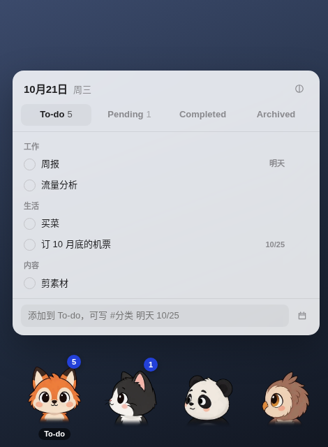

# m-awesome-desk-todo

住在 Mac 右下角的四只桌宠，帮你管待办。头跟着鼠标转，移上去看清单，拖到它身上换分组；数据是一份 Markdown，你的 AI（Claude Code、Codex……）也能直接改。

> **目前只支持 macOS**（Apple 芯片和 Intel 都行，macOS 11 以上）。Windows、Linux 还没做：透明置顶窗口、点击穿透、全局鼠标在别的系统上行为不同，没有验证过。界面目前只有中文。



四个位置各管一个分组：**To-do**（要做）、**Pending**（在等）、**Completed**（最近做完的）、**Archived**（归档）。每个位置放哪只宠物，可以从 57 个内置形象里挑，也可以自己生成。

## 安装

### 让 Agent 帮你装（推荐）

把这句话贴给 Claude Code、Codex 或别的能跑命令的 Agent：

```text
把 https://github.com/MengTang1114-open/m-awesome-desk-todo 装到我的 Mac 上，按仓库里的 AGENTS.md 帮我装好并配置。
```

它会 clone、打包、拷进「应用程序」并打开，然后问你三件事：深色还是浅色、四个位置放哪几只宠物、快速添加用什么快捷键。不想选就说「默认」。

### 自己装

需要 Node 18 以上。

```bash
git clone https://github.com/MengTang1114-open/m-awesome-desk-todo.git
cd m-awesome-desk-todo
npm install
npm run app        # 打包成 .app，在 release/mac*/ 里，拖进「应用程序」
```

`npm start` 不打包直接跑；`npm run dist` 打 .dmg（没签名，别人第一次打开要在「系统设置 → 隐私与安全性」里放行，签名见文末）。

第一次打开，To-do 里有几条「上手任务」，跟着做一遍就会用了。

## 怎么用

- **移上宠物**：出现这个分组的清单；鼠标在宠物或清单上就一直开着，移开就收起。正在输入、开着下拉时先不收。Esc 也能收起。
- **点一下宠物**：它做个表情，清单切到它的分组。**右键宠物**：给这个位置换形象。
- **任务**：底部输入框回车添加，可以顺手写 `#分类` 和日期（`明天`、`周五`、`10/25`、`2026-10-25`）；点圆圈完成，双击改名，悬停出现分类、日期和删除，日期右键清除。
- **分类**（工作 / 生活……）：悬停任务点 `#` 换分类，选「新分组…」新建；双击分类标题给整组改名。
- **快速添加**：任何时候按 ⌥ 空格，To-do 弹出来、光标在输入框里，回车加上，Esc 回到刚才的 App。⌥ 空格被别的 App 占了会自动换成 ⌥⇧ 空格或 ⌃⌥ 空格，菜单栏里写着当前是哪个。
- **换分组**：把任务拖到另一只宠物或上面的标签上；拖到另一条任务上就排到它前面。
- **做完的**：勾掉或拖进 Completed 时自动记下完成日期，按日期分组。只留最近 7 天，更早的自动收进 Archived，不删。不想做的事直接拖进 Archived，显示为划掉。
- **角标**：只有 To-do 和 Pending 显示数字，有过期的变红。
- **深色 / 浅色**：默认跟随系统；清单右上角的按钮或菜单栏「外观」里切换。
- **挪位置**：按住任意一只宠物拖，整排一起走。菜单栏爪印图标里能让它们回到右下角、开机启动。
- 宠物会回应：戳一下做表情，连戳四下会晕；任务进了谁的分组谁就高兴；今天到期的全做完、或 To-do 清空时四只一起庆祝；To-do 堆到 10 条以上，第一只隔一会儿晕一下；很久不动鼠标会一起打瞌睡。没有提醒功能。

## 换形象

内置 57 个形象，来自 [page-mascot](https://github.com/nilbuild/page-mascot)（MIT，© Kamran Ahmed）：动物、职业人物、小机器人，还有同一只狐狸的六种画风。右键任意宠物就能换。

默认是狐狸（To-do）、奶牛猫（Pending）、熊猫（Completed）、猫头鹰（Archived）。


**自己做一个**：用任何生图模型出两张九宫格，交给 Agent 或跑一条命令，不用改代码、不用重新打包。提示词和步骤见 [docs/make-your-own-pet.md](docs/make-your-own-pet.md)。

## 数据和设置：都在一个文件夹里，AI 也能改

`~/Documents/DeskPet/`（环境变量 `DESK_PET_TODO` 可以把 To-Do.md 指到别处，另外两样跟着它走）：

| 文件 | 是什么 |
|---|---|
| `To-Do.md` | 全部待办 |
| `settings.json` | 外观、四个位置的形象、快捷键、Completed 留几天 |
| `pets/<名字>/` | 你自己做的形象 |

三样都是改了就生效（一秒内），所以可以边和 AI 聊天边让它管，比如「把明天要交的周报加进 To-Do」「桌宠换成深色」「Pending 换成水獭」。菜单栏「复制给 AI 的说明」会复制一段路径和格式说明，第一次贴给 AI 就行。

```markdown
## To-do
- [ ] 周报 #工作 due:2026-10-25
## Pending
- [ ] 等设计稿回来 #工作
## Completed
- [x] 交水电费 #生活 done:2026-10-21
## Archived
- [x] 交房租 #生活 done:2026-10-01
- [-] 周末爬山 #生活
```

一行一条，`#分类`、`due:日期`、`done:完成日期` 都可省（做完的没写 `done:` 会补成当天）；Archived 里 `[x]` 是做完的，`[-]` 是不做了。四个分组标题别改（也认「待办 / 进行中 / 已完成 / 归档」，旧的 `Cancelled` 当 Archived）。

```json
{
  "theme": "system",
  "pets": ["fox", "cat", "panda", "owl"],
  "hotkey": "",
  "keepCompletedDays": 7
}
```

`theme`：`system` / `light` / `dark`。`pets`：四个位置依次是 To-do、Pending、Completed、Archived，填内置形象名（见 `public/pets/names.json`）或自己形象的文件夹名。`hotkey`：留空用 ⌥ 空格，也可以写 `Command+Shift+T` 这类（[Electron 快捷键写法](https://www.electronjs.org/docs/latest/api/accelerator)）。

## 开发

```bash
npm install
npm run dev        # 只开浏览器预览界面（数据存在 localStorage，鼠标跟随只在页面内）
npm start          # 打包页面并启动桌宠
npm test           # Markdown 读写、完成日期、自动归档、日期识别
```

| 路径 | 是什么 |
|---|---|
| `electron/main.cjs` | 透明置顶窗口、系统鼠标、点击穿透、读写和监听 To-Do.md / settings.json / pets/、菜单栏、右键换形象 |
| `electron/preload.cjs` | 页面能用的本机能力 |
| `src/App.tsx` | 四只宠物、清单面板、拖放、增删改 |
| `src/Pet.tsx` | 一只宠物：按鼠标方向换朝向，戳一下做表情（改自 page-mascot） |
| `src/todoMd.js` | To-Do.md 的解析和写出、自动归档、快速添加里的日期识别 |
| `public/pets/` | 内置形象（每个两张 webp）、`index.json` 清单、`names.json` 中文名 |
| `scripts/add_pet.py` | 用户自己的九宫格 → 去背景、统一大小 → `~/Documents/DeskPet/pets/` |
| `scripts/key.py` | 去纯色背景（来自 page-mascot） |
| `scripts/normalize.py` | 统一大小、对齐底边 |
| `scripts/import_page_mascot.sh` | 从 page-mascot 重新导入内置形象 |
| `scripts/ui_check.py` | 在浏览器里把整个交互走一遍并截图 |

数据格式（`src/todoMd.js`）是对外接口：AI 和用户会手改 To-Do.md，改格式要向后兼容并补测试。

### 签名和公证（发给别人用时）

需要 Apple Developer Program。钥匙串里装好「Developer ID Application」证书，然后：

```bash
export APPLE_ID=你的 Apple ID
export APPLE_APP_SPECIFIC_PASSWORD=App 专用密码（appleid.apple.com 生成）
export APPLE_TEAM_ID=团队 ID
npm run dist:signed
```

## 许可证

MIT，见 [LICENSE](LICENSE)；第三方声明见 [THIRD_PARTY_NOTICES](THIRD_PARTY_NOTICES)。内置形象、`src/Pet.tsx` 的转头和表情逻辑、`scripts/key.py` 和自己做形象的提示词来自 [page-mascot](https://github.com/nilbuild/page-mascot)（MIT，© Kamran Ahmed）。
